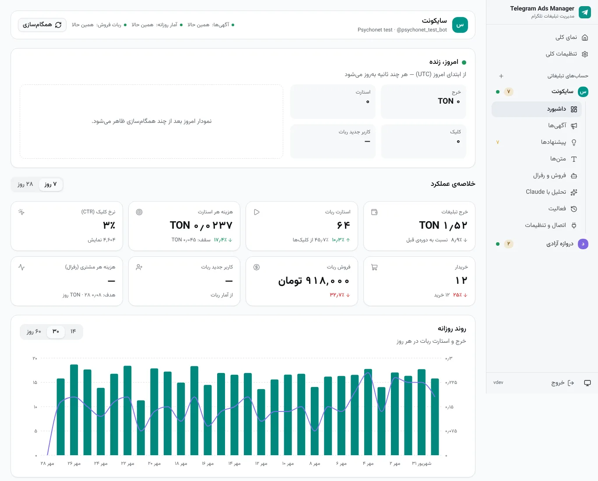
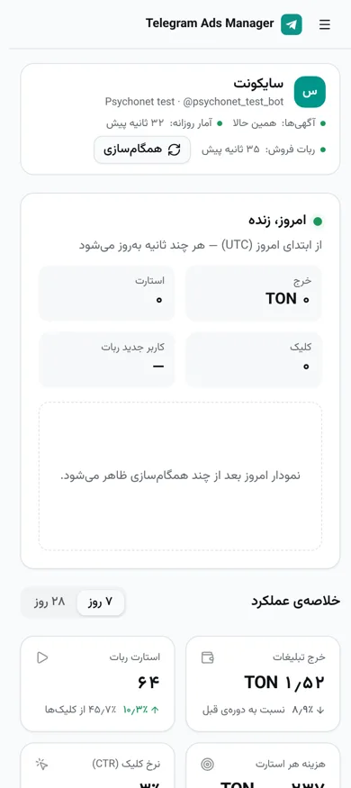
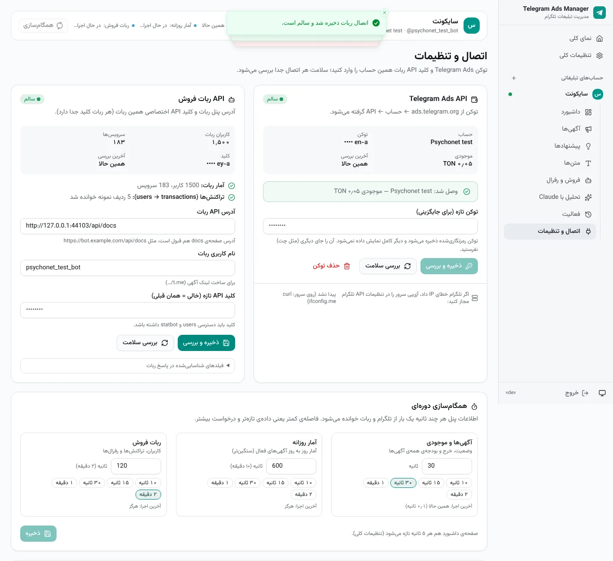
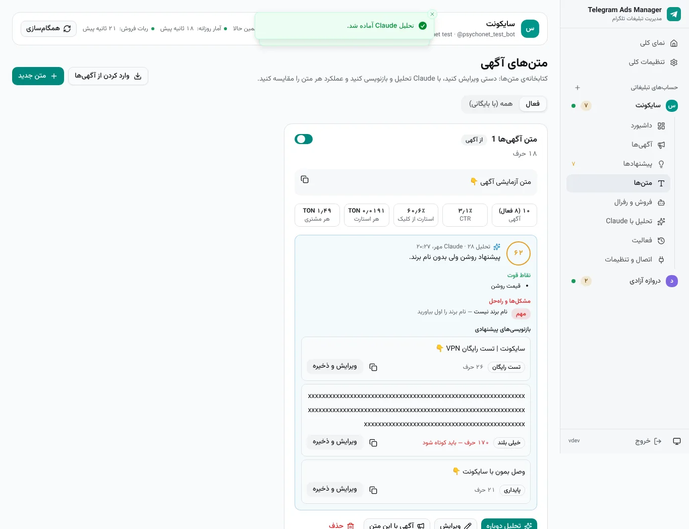

<div dir="rtl">

# Telegram Ads Manager

[](https://github.com/danialrahimian/telegram-ads-manager/actions/workflows/ci.yml)


**پنل خودمیزبان برای مدیریت چند حساب Telegram Ads، ردیابی فروش هر آگهی از طریق API ربات فروش، و تحلیل و بازنویسی متن‌ها با Claude.**

هر حساب تبلیغاتی (مثلاً یکی برای «سایکونت» و یکی برای «دروازه آزادی») مسیر، داشبورد، اتصال‌ها، قوانین و تحلیل جداگانه‌ی خودش را دارد. پنل فارسی و راست‌به‌چپ است و روی موبایل هم کامل کار می‌کند.

<p align="center">
  
  
</p>

<sub>تصویرها از داده‌ی آزمایشی (mock) گرفته شده‌اند.</sub>

## امکانات

| | |
|---|---|
| 🧭 **چند حساب، کاملاً جدا** | هر حساب Telegram Ads با ربات خودش در مسیر `/accounts/<slug>` داشبورد، آگهی‌ها، پیشنهادها، متن‌ها و تحلیل جدا دارد. |
| 🔌 **اتصال از داخل داشبورد** | توکن Telegram Ads و آدرس + کلید API هر ربات در صفحه‌ی «اتصال و تنظیمات» همان حساب وارد می‌شود و سلامت هر اتصال جدا بررسی می‌شود. کلیدها رمزنگاری‌شده (Fernet) ذخیره می‌شوند. |
| 🔄 **همگام‌سازی دوره‌ای قابل تنظیم** | آگهی‌ها و موجودی (پیش‌فرض هر ۳۰ ثانیه)، آمار روزانه (۱۰ دقیقه) و ربات فروش (۲ دقیقه) — برای هر حساب جدا قابل تغییر؛ داشبورد هم هر چند ثانیه خودش تازه می‌شود. |
| 🏷️ **ردیابی فروش هر آگهی (رفرال)** | هر گروه آگهی با لینک دعوت یک حساب معرف جدا در ربات ساخته می‌شود (`?start=`). کاربران دعوت‌شده و خریدهایشان از API ربات خوانده می‌شوند و **هزینه‌ی هر مشتری** برای هر آگهی و برچسب حساب می‌شود. |
| ✍️ **متن‌ها با Claude** | کتابخانه‌ی متن با ویرایش دستی، تحلیل Claude (امتیاز، نقاط قوت، مشکل‌ها) و سه بازنویسی که قبل از ذخیره قابل ویرایش‌اند؛ عملکرد هر متن (CTR، هزینه‌ی هر استارت و مشتری) کنارش دیده می‌شود. |
| 💡 **پیشنهاد + تأیید** | قوانین قابل تنظیم پیشنهاد می‌دهند: توقف آگهی پرهزینه، پس گرفتن بودجه‌ی بلااستفاده، شارژ آگهی خوب، تازه کردن متن خسته. هیچ پولی بدون تأیید شما جابه‌جا نمی‌شود؛ سقف شارژ روزانه و توقف اضطراری هم هست. |
| 📊 **تحلیل حساب با Claude** | سؤال بپرسید یا تحلیل کامل بگیرید؛ یا خروجی ZIP (CSV + راهنما) را در claude.ai بارگذاری کنید. |
| 📱 **رابط shadcn/ui** | React + TypeScript + Tailwind، حالت تیره، تاریخ شمسی، جدول‌ها روی موبایل به کارت تبدیل می‌شوند. |

<p align="center">
  
  
</p>

## نصب با یک دستور

روی یک VPS خارج از ایران (Ubuntu 24.04 پیشنهادی، یا Debian) با دسترسی root. رکورد A دامنه باید به IP سرور اشاره کند و پورت‌های ۸۰ و ۴۴۳ آزاد باشند.

<div dir="ltr">

```bash
sudo bash -c "$(curl -fsSL https://github.com/danialrahimian/telegram-ads-manager/raw/main/install.sh)" @ install
```

</div>

اسکریپت **فقط دو چیز می‌پرسد: دامنه و رمز پنل.** بقیه را خودش انجام می‌دهد: Docker را نصب می‌کند، کلیدهای امنیتی را می‌سازد، HTTPS را با Caddy راه می‌اندازد، دستور `tgads` را می‌سازد و پشتیبان‌گیری روزانه را تنظیم می‌کند.

بعد از نصب:
1. وارد `https://دامنه‌ی-شما` شوید.
2. برای هر ربات یک حساب بسازید (مثلاً `psychonet` و `darvaze`).
3. در «اتصال و تنظیمات» هر حساب:
   - **توکن Telegram Ads** را از ads.telegram.org ← API بگیرید و وارد کنید. اگر در تلگرام محدودیت IP گذاشته‌اید، IP سرور (که همان‌جا نمایش داده می‌شود) را مجاز کنید.
   - **آدرس API ربات** (آدرس صفحه‌ی docs هم قبول است)، **نام کاربری ربات** و **کلید API همان ربات** را وارد کنید. کلید باید دسترسی `users` و `statbot` داشته باشد.
4. در «تنظیمات کلی» کلید Claude را وارد کنید (اختیاری).

> توکن‌ها و کلیدها را فقط داخل پنل وارد کنید؛ در چت، تیکت یا گیت‌هاب نفرستید.

**ارتقا از نسخه‌ی ۱ (`psychonet-ads`):** همان دستور نصب را اجرا کنید. دامنه، رمز و توکن قبلی خودکار منتقل می‌شوند، سرویس قدیمی متوقف می‌شود و داده‌ی آن در `/opt/psychonet-ads` باقی می‌ماند.

نصب بدون سؤال: `DOMAIN=ads.example.com ADMIN_PASSWORD='...' bash install.sh install`

## دستور مدیریت `tgads`

<div dir="ltr">

| Command | |
|---|---|
| `tgads status` | version, health, containers |
| `tgads logs [app\|caddy]` | follow logs |
| `tgads update [--version vX.Y.Z]` | update or roll back (backs up first) |
| `tgads backup` / `tgads restore <file>` | database + keys backup (daily at 03:30) |
| `tgads password [new]` | change the panel password |
| `tgads restart` · `start` · `stop` · `edit` · `uninstall` | |

</div>

## ردیابی فروش هر آگهی چطور کار می‌کند؟

<div dir="ltr">

```
Ad (t.me/yourbot?start=ref_tech) ──▶ user starts the bot as a referral of account 9001
        │                                         │
        ▼                                         ▼
Telegram Ads API: spend, views, starts     Bot API: affiliates_users(9001), transactions
        └──────────────▶ cost per customer = ad spend ÷ buyers referred by 9001 ◀──────┘
```

</div>

1. در ربات برای هر گروه آگهی یک حساب معرف بسازید.
2. در صفحه‌ی «فروش و رفرال» شناسه‌ی عددی آن را به‌عنوان برچسب وارد کنید (دکمه‌ی «بررسی» وجودش را تأیید می‌کند).
3. موقع ساخت یا ویرایش آگهی برچسب را انتخاب کنید تا لینک آگهی `?start=کد` بگیرد.
4. کاربران دعوت‌شده و خریدهایشان (نوع تراکنش‌های خرید در تنظیمات حساب قابل تغییر است) خودکار خوانده و به آگهی وصل می‌شوند.

## ساختار پروژه

<div dir="ltr">

```
backend/                 FastAPI · SQLAlchemy 2 (async) · SQLite (WAL) · Alembic · Pydantic v2
  app/core/              settings, encryption, security, errors, logging
  app/models/            accounts, ads, stats, referral tags, bot users & transactions, texts, jobs…
  app/integrations/      Telegram Ads API, sales-bot API, Claude API clients
  app/services/          sync, metrics, rules, actions, ads, texts, referrals, analysis
  app/api/v1/routes/     REST API (/api/v1), session cookie + CSRF
  app/workers/           per-account sync scheduler + job queue (single process)
  tests/                 pytest (respx mocks) · tests/e2e Playwright · tests/mocks fake APIs
frontend/                React 19 · Vite · TypeScript · Tailwind v4 · shadcn/ui (Radix) · TanStack Query
  src/components/ui/     shadcn components (RTL)
  src/pages/account/     per-account pages: dashboard, ads, proposals, texts, sales, analysis, activity, settings
deploy/                  docker-compose.yml + Caddyfile used by the installer
install.sh               installer and `tgads` management command
```

</div>

## توسعه

<div dir="ltr">

```bash
# backend (needs uv)
cd backend && uv sync
ADMIN_PASSWORD=devpassword SESSION_SECRET=$(openssl rand -hex 24) \
ENCRYPTION_KEY=$(openssl rand -base64 32 | tr '+/' '-_') COOKIE_SECURE=0 \
uv run uvicorn app.main:app --reload

# fake Telegram Ads / bot / Claude APIs for local testing
uv run python -m tests.mocks.server   # tokens: mocktoken-a, mocktoken-b · bot keys: botkey-a, botkey-b
# start the backend with TG_ADS_API_BASE=http://127.0.0.1:8790 ANTHROPIC_API_BASE=http://127.0.0.1:8792

# frontend (proxies /api to :8000)
cd frontend && pnpm install && pnpm dev

# checks
cd backend && uv run ruff check . && uv run mypy app && uv run pytest
cd frontend && pnpm lint && pnpm typecheck && pnpm test && pnpm build
cd backend && RUN_E2E=1 uv run --group e2e pytest tests/e2e   # after `pnpm build`
sudo bash tests/installer/test_install.sh
```

</div>

## امنیت

- پنل فقط با رمز باز می‌شود؛ کوکی نشست `HttpOnly` و `Secure` است، درخواست‌های تغییر‌دهنده توکن CSRF می‌خواهند و تلاش‌های ناموفق ورود محدود می‌شوند.
- توکن Telegram Ads، کلید ربات‌ها و کلید Claude با `ENCRYPTION_KEY` رمزنگاری می‌شوند و فقط چهار حرف آخرشان نمایش داده می‌شود. فایل پشتیبان کلید را هم دارد؛ آن را خصوصی نگه دارید.
- برنامه فقط روی `127.0.0.1` گوش می‌دهد و از بیرون فقط از طریق Caddy (HTTPS) در دسترس است.
- هر جابه‌جایی پول (شارژ/برداشت) کلید idempotency دارد و سقف‌های ایمنی قابل تنظیم است.

## مجوز

MIT

</div>
